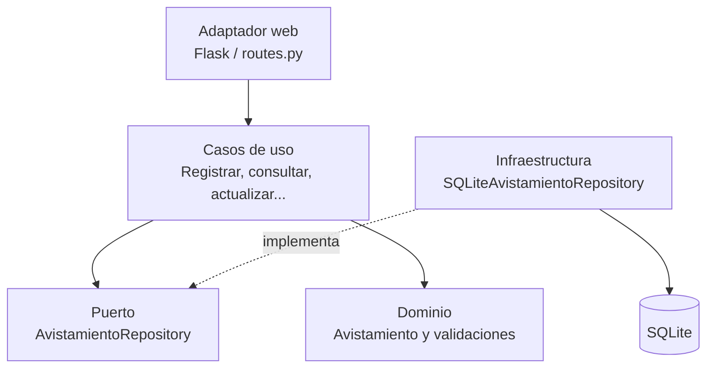

# Taller 5. Clean Architecture y arquitectura hexagonal

**Asignatura:** Ingeniería de Software 2  
**Proyecto:** API REST de avistamientos de aves  
**Estudiante:** Ana Maria Luna  
**Repositorio:** https://github.com/lunaa06/api-avistamientos  
**Arquitectura elegida para la propuesta:** Clean Architecture

---

## Parte 1. Investigación

### 1. Arquitectura hexagonal: problema, puertos, adaptadores y simetría

Cockburn parte de un problema que se repetía en las aplicaciones: la lógica del negocio terminaba mezclada con la interfaz de usuario. Eso hacía que probar el sistema fuera más difícil, porque una regla del negocio podía depender de detalles visuales o de la tecnología utilizada para recibir los datos. También complicaba cambiar la forma de usar la aplicación, por ejemplo, pasar de una interfaz para personas a un proceso automático (Cockburn, 2005).

En su propuesta, un **puerto** es el punto de comunicación que define qué necesita o qué ofrece la aplicación. Se puede entender como un contrato o una API que no depende de una tecnología específica. Un **adaptador** es el componente que traduce la comunicación de una tecnología externa para que pueda utilizar ese puerto. Por ejemplo, una ruta HTTP puede actuar como adaptador de entrada, mientras que un componente que se comunica con SQLite puede actuar como adaptador de salida.

Cockburn habla de simetría porque la aplicación se encuentra en el centro y se comunica con elementos externos mediante puertos. La interfaz de usuario y la base de datos están fuera de la aplicación; ninguna debe tener un trato privilegiado ni mezclarse con las reglas internas. Así, la aplicación podría recibir información desde una página web, una prueba automática o un proceso por lotes, y guardar información en SQLite, en otro motor o en una base simulada, sin cambiar la lógica central (Cockburn, 2005).

### 2. Los círculos de Clean Architecture y la regla de dependencia

Martin representa Clean Architecture con círculos concéntricos. Desde el centro hacia afuera se encuentran:

- **Entidades (Entities):** contienen las reglas de negocio más generales y los conceptos principales del sistema.
- **Casos de uso (Use Cases):** representan las acciones que la aplicación permite realizar y coordinan el trabajo necesario para cumplirlas.
- **Adaptadores de interfaz (Interface Adapters):** convierten los datos entre el formato interno de los casos de uso y el formato que necesitan elementos externos, como controladores o mecanismos de persistencia.
- **Frameworks y controladores externos (Frameworks and Drivers):** contienen herramientas concretas, como Flask, SQLite y otros detalles técnicos.

La regla principal es que las dependencias del código deben apuntar hacia adentro, hacia las políticas de mayor nivel. Esto significa que las entidades y los casos de uso no deben conocer ni importar detalles de los círculos externos. Por ejemplo, una regla del negocio no debería depender de Flask, de una solicitud HTTP ni de una fila devuelta directamente por SQLite (Martin, 2012).

### 3. Cómo guardar datos sin que el caso de uso dependa de la base de datos

La solución es utilizar una abstracción o interfaz definida desde el lado interno de la aplicación. El caso de uso conoce esa interfaz, pero no necesita saber qué tecnología la implementa. Luego, un componente externo implementa el contrato y realiza la operación real sobre la base de datos. Esto aplica el principio de inversión de dependencias: el código de alto nivel no depende directamente del detalle de bajo nivel (Martin, 2012).

Por ejemplo, para registrar un avistamiento se puede definir un contrato llamado `AvistamientoRepository` con una operación `guardar(avistamiento)`. El caso de uso `RegistrarAvistamiento` recibe un objeto que cumple ese contrato y le solicita guardar el registro. En la parte externa, una implementación `SQLiteAvistamientoRepository` realiza el `INSERT` correspondiente. De esta manera, el caso de uso no importa SQLite ni ejecuta instrucciones SQL. Si más adelante se cambia SQLite por PostgreSQL, se sustituye la implementación del repositorio sin modificar la regla del caso de uso (Martin, 2012).

### 4. Comparación entre arquitectura hexagonal, de cebolla y Clean Architecture

Las tres propuestas buscan mantener las reglas de negocio independientes de los detalles externos. También promueven la separación de responsabilidades, facilitan las pruebas y buscan evitar que la interfaz o la base de datos controlen la estructura interna del sistema (Cockburn, 2005; Palermo, 2008; Martin, 2012).

Lo que cambia principalmente es la forma de explicar y organizar esa idea:

- **Arquitectura hexagonal:** utiliza el vocabulario de puertos y adaptadores. Destaca que la aplicación se comunica con distintos elementos externos por contratos, y que esos elementos pueden sustituirse.
- **Arquitectura de cebolla:** organiza el sistema alrededor de un núcleo de dominio. Las dependencias siempre se dirigen hacia las capas más centrales. En el núcleo pueden existir contratos de repositorio, mientras que sus implementaciones quedan en la infraestructura externa.
- **Clean Architecture:** presenta círculos con nombres concretos —entidades, casos de uso, adaptadores de interfaz y frameworks— y formula de manera explícita la regla de dependencia hacia adentro.

No se trata simplemente de que una tenga más capas que otra. También cambia el énfasis y el vocabulario con el que se expresa la separación. En la práctica comparten muchas ideas: el dominio no debería depender del framework ni de la base de datos, y los detalles externos deben conectarse mediante abstracciones (Cockburn, 2005; Palermo, 2008; Martin, 2012).

### 5. ¿Vale la pena usar Clean Architecture en una API pequeña?

Considero que sí puede valer la pena en esta API, siempre que la estructura se mantenga sencilla y no se creen capas solo por cumplir un diagrama. Aunque el proyecto tiene pocos endpoints, ya cuenta con reglas de validación, operaciones de consulta y escritura, persistencia con SQLite y pruebas. Separar esas responsabilidades ayuda a entender dónde está cada comportamiento y permite probar los casos de uso sin depender de Flask o de una base de datos real.

El beneficio concreto es que si se cambia la forma de guardar los avistamientos, la lógica de registrar, consultar o eliminar no tendría que modificarse por ese motivo. También sería más fácil probar las reglas de la aplicación de manera aislada. El costo es que aparecen más archivos, contratos y objetos que deben conectarse. Para una API pequeña, eso puede sentirse como trabajo adicional y hacer que una modificación sencilla requiera recorrer más componentes.

Mi posición es aplicar Clean Architecture, pero de forma proporcional al tamaño del proyecto. Mantendría las capas necesarias —dominio, aplicación, adaptadores e infraestructura— sin agregar abstracciones que todavía no tengan un propósito. Así se obtiene una separación útil sin convertir una API pequeña en una estructura difícil de mantener.

---

## Parte 2. Aplicación: propuesta de organización

### Arquitectura elegida

Para reorganizar la API de avistamientos se eligió **Clean Architecture**. La razón es que permite explicar de manera clara cuáles son las reglas del negocio, cuáles son los casos de uso y cuáles son los detalles técnicos que se pueden reemplazar.

### Estado inicial observado en el repositorio

En la versión consultada del repositorio, `app.py` contiene las rutas HTTP y también realiza directamente las consultas SQL mediante la función `conectar`. El archivo `database.py` abre la conexión SQLite y crea la tabla, mientras que `validador.py` ya mantiene separadas varias reglas de validación. Las pruebas se encuentran en `tests/test_api.py` y `tests/test_validador.py`.

Esto muestra que ya existía un primer paso de separación con el validador, pero las rutas todavía coordinaban la validación y el acceso a datos. La propuesta es mover esa coordinación a casos de uso y dejar las tecnologías externas en la capa de infraestructura.

### Estructura de carpetas propuesta

La estructura implementada en la rama es:

```text
api-avistamientos/
├── avistamientos/
│       ├── domain/
│       │   ├── entities/
│       │   │   └── avistamiento.py
│       │   └── services/
│       │       └── validador.py
│       ├── application/
│       │   ├── ports/
│       │   │   └── avistamiento_repository.py
│       │   └── use_cases/
│       │       └── avistamientos.py
│       ├── adapters/
│       │   └── web/
│       │       └── routes.py
│       └── infrastructure/
│           └── persistence/
│               └── sqlite_avistamiento_repository.py
├── tests/
│   ├── test_api.py
│   └── test_validador.py
├── docs/
│   └── taller5_clean_architecture.md
├── requirements.txt
└── README.md
```

La estructura refleja los archivos presentes en la rama de trabajo. Los casos de uso se agruparon en un solo módulo para mantener la solución proporcionada al tamaño de esta API.

### Responsabilidad de cada parte

- **Dominio:** contiene la entidad `Avistamiento` y las reglas propias de los datos, como las validaciones de especie, fecha, lugar y observador.
- **Aplicación:** contiene los casos de uso que coordinan las operaciones de registrar, listar, consultar, actualizar, eliminar y obtener el resumen. Define también el contrato `AvistamientoRepository`.
- **Adaptadores:** reciben las solicitudes HTTP de Flask, convierten los datos de entrada al formato esperado por los casos de uso y construyen las respuestas.
- **Infraestructura:** implementa el contrato de repositorio utilizando SQLite. Aquí se ubican las consultas SQL y los detalles concretos de conexión.

### Diagrama de dependencias



Las flechas continuas representan dependencias del código. La implementación SQLite satisface el contrato definido en el interior, pero el contrato no conoce SQLite. Por eso, la dirección de las dependencias se mantiene hacia las reglas internas, como propone Martin (2012).

### Evidencia de pruebas y cobertura

Se ejecutó la suite de pruebas localmente después del refactor, desde la rama `taller5-clean-architecture`, con Python 3.14.6, pytest 9.2.0 y pytest-cov 7.1.0.

Comando de pruebas:

```powershell
python -m pytest -v
```

Resultado real: **24 pruebas aprobadas, 0 fallidas**, en 0.66 segundos.

Comando de cobertura:

```powershell
python -m pytest --cov=avistamientos --cov=app --cov=validador --cov-report=term-missing
```

Resultado real: **98 % de cobertura total** (182 sentencias medidas y 4 sin cubrir). Los módulos de rutas, casos de uso, entidad, validador y repositorio SQLite registraron 100 % en esta ejecución. La cobertura de `app.py` fue 88 % y el contrato `avistamiento_repository.py` quedó en 0 %, porque es una interfaz de definición y no contiene lógica ejecutable relevante.

| Evidencia | Antes del refactor | Después del refactor |
|---|---|---|
| Resultado de pytest | No se guardó una medición de referencia antes de reorganizar | 24 pruebas aprobadas, 0 fallidas |
| Cobertura | No se guardó una medición de referencia antes de reorganizar | 98 % |
| Respuesta HTTP | No se guardó una captura comparativa anterior | Las pruebas de API verificaron los endpoints y sus respuestas esperadas |

**Alcance de la evidencia:** los resultados anteriores corresponden a la versión refactorizada. Como no se tomó una medición antes del cambio, no se presenta una comparación numérica antes/después ni se afirma una equivalencia completa para escenarios que no estén cubiertos por las pruebas. Se recomienda conservar una captura de la terminal con el resultado de pytest y otra con el reporte de cobertura como evidencia para Aula Virtual.

### Commits del proceso

El refactor se desarrolló mediante varios commits en la rama `taller5-clean-architecture`, manteniendo `main` separado. Los cambios se organizaron progresivamente para crear la estructura, separar el dominio y los casos de uso, implementar la persistencia SQLite, conectar las rutas y documentar el avance. El último ajuste de esta etapa también agregó `.coverage` al archivo `.gitignore` para evitar subir el reporte temporal generado por pytest-cov.

### Lo más difícil de separar

Lo que puede resultar más difícil es separar el acceso a datos de las rutas, porque en la versión inicial ambos están bastante relacionados: las funciones de Flask reciben la petición, llaman al validador y ejecutan consultas SQL. Al principio parece más rápido resolverlo todo en una sola función, pero esa mezcla hace que los cambios en la base de datos también afecten al código que responde las solicitudes.

Para separarlo, hay que decidir qué información necesita cada caso de uso y definir un contrato de repositorio que responda a esa necesidad. Después, la implementación SQLite se encarga de traducir ese contrato a consultas concretas. Esta parte requiere cuidado porque la API debe conservar sus respuestas y códigos HTTP, y las pruebas anteriores deben seguir funcionando.

---

## Referencias

Cockburn, A. (2005). *Hexagonal architecture: The original 2005 article*. https://alistair.cockburn.us/hexagonal-architecture/

Martin, R. C. (2012, 13 de agosto). *The Clean Architecture*. The Clean Code Blog. https://blog.cleancoder.com/uncle-bob/2012/08/13/the-clean-architecture.html

Palermo, J. (2008, 29 de julio). *The Onion Architecture: Part 1*. Programming with Palermo. https://jeffreypalermo.com/2008/07/the-onion-architecture-part-1/


---

## Estado del refactor en la rama `taller5-clean-architecture`

Se comenzó la reorganización del código en esta rama, sin modificar `main`. La estructura implementada hasta este punto separa:

- `avistamientos/domain/entities/avistamiento.py`: entidad del dominio.
- `avistamientos/domain/services/validador.py`: reglas de validación y reloj.
- `avistamientos/application/ports/avistamiento_repository.py`: contrato de persistencia.
- `avistamientos/application/use_cases/avistamientos.py`: coordinación de las operaciones de la aplicación.
- `avistamientos/infrastructure/persistence/sqlite_avistamiento_repository.py`: implementación con SQLite.
- `avistamientos/adapters/web/routes.py`: rutas HTTP mediante Flask.
- `app.py`: composición de los componentes y creación de la aplicación.

El archivo raíz `validador.py` conserva una importación de compatibilidad para las pruebas que ya lo utilizaban. La aplicación Flask utiliza el validador ubicado en el dominio.

**Verificación local realizada:** la suite de pruebas ejecutada en esta rama obtuvo 24 resultados aprobados y el reporte de cobertura indicó 98 %. La carpeta de trabajo local está sincronizada con la rama remota y el árbol de trabajo quedó limpio después de registrar el ajuste del archivo `.gitignore`. La comparación cuantitativa con una ejecución anterior no está disponible porque no se guardó una línea base antes del refactor.
